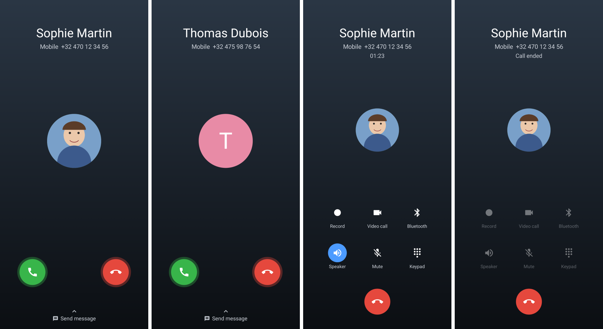

# Callme

Android app (sideloaded APK) that fakes an incoming phone call from one of your
favorite contacts at a time you choose, with a Samsung One UI–style call screen,
the contact's photo, your ringtone, and a "someone talking" voice once answered.

See [SPEC.md](SPEC.md) for the full behaviour.



## Install on the phone

1. Open the repository's **Actions** tab → latest **Build APK** run → download the
   `Callme-…` artifact (a zip containing the APK). Tagged versions (`v*`) are also
   attached to **Releases**.
2. Copy the APK to the phone and open it. Allow "Install unknown apps" for the app
   you open it with (My Files, Chrome…) when asked.
3. Open Callme and tap **Allow** on each item of the *Setup needed* card:
   contacts, notifications, full-screen call screen, and battery **Unrestricted**.

### Samsung tips
- Settings → Battery → Background usage limits: make sure Callme is **not** in
  "Sleeping apps" / "Deep sleeping apps".
- If you use **Do Not Disturb**, add Callme to the allowed apps
  (Settings → Notifications → Do not disturb → Apps), otherwise the call screen
  may be hidden while DND is on (the phone will still vibrate).

## Behaviour summary
- Pick a starred contact (and a number, if they have several), then a time:
  quick picks *in 1/5/15/30 min* or any date and time.
- Up to **3** calls can wait at once.
- Normal ringer mode: rings with your ringtone (+ vibration if enabled in
  system settings). Vibrate / Silent / Do Not Disturb: vibrates only.
- Volume keys or the power button silence the ringer.
- Rings for **20 s**. If **declined or missed**, the contact calls back **once,
  90 s later**. Missed calls show a "Missed call" notification.
- Answering plays an unintelligible voice in the earpiece (speaker button
  switches to loudspeaker). Holding the phone to your ear turns the screen off.
- Nothing is written to the real call log; no internet permission.

## Build locally

Requirements: JDK 17+, Android SDK (platform 35).

```bash
./gradlew assembleRelease
```

The APK is in `app/build/outputs/apk/release/`.

Call-screen snapshot tests (rendered on the JVM with Paparazzi, no device needed):

```bash
./gradlew verifyPaparazziDebug
```

After an intentional UI change, re-record them with `./gradlew recordPaparazziDebug`.

### Stable signing key (recommended)

Android only installs an update over an existing app if both are signed with the
same key. Without a key, CI signs with a throwaway debug key and you must
uninstall before installing a newer build. To use a stable key:

```bash
keytool -genkeypair -v -keystore callme.jks -alias callme -keyalg RSA -keysize 2048 -validity 10000
```

```bash
base64 -w0 callme.jks
```

Add these repository secrets (Settings → Secrets and variables → Actions):
`CALLME_KEYSTORE_BASE64` (the base64 output), `CALLME_KEYSTORE_PASSWORD`,
`CALLME_KEY_ALIAS` (`callme`), `CALLME_KEY_PASSWORD`. Keep `callme.jks` safe and
never commit it.

## Project layout
- `app/src/main/java/com/pythdom/callme/`
  - `data/` – pending-call storage, favorites and contact photos
  - `scheduling/` – exact alarms, reboot re-arming
  - `call/` – ringing foreground service, call state, notifications
  - `ui/` – home/scheduling screens and the Samsung-style call screens
- `app/src/main/res/raw/mumble.ogg` – synthesized voice, generated by
  `tools/generate_mumble.py`
